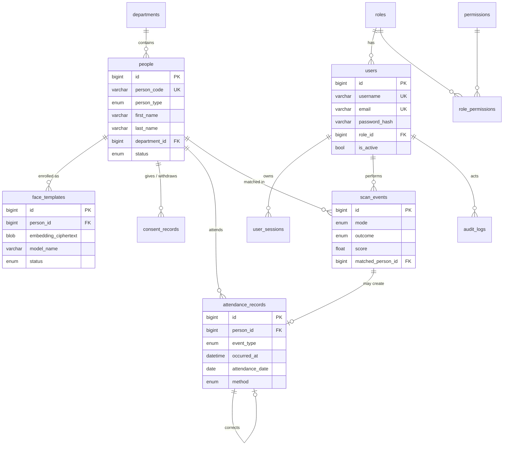

# 2. Database Schema

**Engine:** PostgreSQL 18 (15+ supported). **Encoding:** UTF-8 with ICU root collation (`und`),
so Khmer text is stored and sorted correctly. Alembic migrations are the source of truth; this
document describes what they create. (The project started on MySQL 8. The old migration is kept in
`backend/alembic/legacy_mysql/` for reference only.)

**Conventions**

- PK `id BIGINT GENERATED BY DEFAULT AS IDENTITY`, except join tables and `system_settings`.
- Every timestamp is `timestamptz`, read and written as **UTC** by the app. `attendance_date` is
  the one deliberate exception: a `date` in the configured local timezone (`Asia/Phnom_Penh`), so
  that "today" means the local day.
- `created_at` / `updated_at` on every mutable table, with server default `now()`.
- **Enumerations** are `VARCHAR(20)` + a `CHECK` constraint (`ck_<table>_<enum>`) listing the
  allowed values, which match Python `enum.Enum` classes. Native PostgreSQL `ENUM` types were
  avoided because values can't be removed and they need separate `CREATE/DROP TYPE` steps.
- JSON columns are `JSONB` (indexable, and queryable with `->>`).
- Named constraints (`pk_`, `fk_`, `uq_`, `ix_`, `ck_`) come from a SQLAlchemy naming convention, so
  migrations are deterministic.
- **Foreign-key indexes:** PostgreSQL does not index FK columns automatically. Every FK that can
  cascade or is filtered on has an index: references to `people`, `scan_events`,
  `attendance_records` and `permissions`, plus `users.role_id` and `user_sessions.user_id`. A test
  enforces this. Audit-style references to `users` (`created_by`, `recorded_by`, …) are left
  unindexed on purpose, because operator accounts are deactivated, never deleted.
- **Case:** text comparison is case-sensitive in PostgreSQL. `users.username`, `users.email` and
  `people.email` are stored lowercase, enforced by `CHECK (col = lower(col))`, so their unique
  constraints are effectively case-insensitive.
- Biometric data is never stored in plain text: templates are AES-GCM ciphertext (`bytea`), and
  scan images are never stored.

## 2.1 Entity-relationship diagram

## 2.2 Tables

### `roles`
| Column | Type | Notes |
|--------|------|-------|
| id | BIGINT identity PK | |
| name | VARCHAR(50) **UNIQUE** | `admin`, `hr`, `viewer` |
| display_name | VARCHAR(100) | e.g. "HR / Teacher" |
| description | VARCHAR(255) NULL | |
| is_system | BOOLEAN default false | System roles cannot be deleted |
| created_at, updated_at | timestamptz | |

### `permissions`
| Column | Type | Notes |
|--------|------|-------|
| id | BIGINT identity PK | |
| code | VARCHAR(64) **UNIQUE** | e.g. `people.write` (full list in [01-architecture §1.3](01-architecture.md#13-roles--permissions)) |
| description | VARCHAR(255) | |

### `role_permissions`
| Column | Type | Notes |
|--------|------|-------|
| role_id | FK → roles.id ON DELETE CASCADE | composite PK |
| permission_id | FK → permissions.id ON DELETE CASCADE | composite PK |

### `users` (system operators, not the people being recognised)
| Column | Type | Notes |
|--------|------|-------|
| id | BIGINT identity PK | |
| username | VARCHAR(50) **UNIQUE** | 3–50 chars, `[a-z0-9._-]` |
| email | VARCHAR(255) **UNIQUE** | |
| full_name | VARCHAR(150) | |
| password_hash | VARCHAR(255) | Argon2id |
| role_id | FK → roles.id, **ix** | One role per user |
| is_active | BOOLEAN default true | |
| failed_login_count | SMALLINT default 0 | Lockout counter |
| locked_until | timestamptz NULL | |
| last_login_at | timestamptz NULL | |
| password_changed_at | timestamptz | Tokens issued before this are rejected |
| created_at, updated_at | timestamptz | |

### `user_sessions` (refresh tokens)
| Column | Type | Notes |
|--------|------|-------|
| id | BIGINT identity PK | |
| user_id | FK → users.id ON DELETE CASCADE, **ix** | |
| token_hash | CHAR(64) **UNIQUE** | SHA-256 of the opaque refresh token. The raw token is never stored. |
| family_id | CHAR(36), **ix** | One sign-in. All rows created by rotating that sign-in's refresh token share it. |
| expires_at | timestamptz | |
| rotated_at | timestamptz NULL | The token was exchanged for a new one. Presenting it again is treated as theft, and the family is revoked. Access tokens issued from this row stay valid until they expire. |
| revoked_at | timestamptz NULL | The sign-in ended (logout, password change, reuse, expiry). Access tokens for this row are rejected immediately. |
| ip_address | VARCHAR(45) | |
| user_agent | VARCHAR(255) | |
| created_at | timestamptz | |

### `departments` (departments **or** classes)
| Column | Type | Notes |
|--------|------|-------|
| id | BIGINT identity PK | |
| code | VARCHAR(20) **UNIQUE** | e.g. `IT`, `G12-A` |
| name | VARCHAR(150) | |
| name_km | VARCHAR(150) NULL | Khmer name |
| kind | VARCHAR + CHECK (DEPARTMENT,CLASS) | |
| is_active | BOOLEAN default true | |
| created_at, updated_at | timestamptz | |

### `people` (employees / students)
| Column | Type | Notes |
|--------|------|-------|
| id | BIGINT identity PK | Internal ID |
| person_code | VARCHAR(30) **UNIQUE** | Public ID, auto-generated (`EMP-2026-00042`, `STU-2026-00007`). An admin may supply one instead (e.g. an existing student number), and it is checked for uniqueness. |
| person_type | VARCHAR + CHECK (EMPLOYEE,STUDENT), **ix** | |
| first_name, last_name | VARCHAR(100) | Required |
| name_km | VARCHAR(200) NULL | Full name in Khmer |
| department_id | FK → departments.id ON DELETE RESTRICT, NULL, **ix** | |
| position | VARCHAR(100) NULL | Position (employee) or grade (student) |
| email | VARCHAR(255) NULL **UNIQUE** | Requires `people.contact.read` to view |
| phone | VARCHAR(30) NULL | Requires `people.contact.read` to view |
| status | VARCHAR + CHECK (ACTIVE,INACTIVE,ARCHIVED) default ACTIVE, **ix** | See lifecycle below |
| photo_file | VARCHAR(64) NULL | Random file ID of the *encrypted* photo in `storage/photos/`. Not a URL. |
| joined_on | DATE NULL | |
| archived_at | timestamptz NULL | Starts the retention clock |
| erased_at | timestamptz NULL | Set when personal data is anonymised |
| created_by, updated_by | FK → users.id NULL | |
| created_at, updated_at | timestamptz | |

Index: `ix_people_name (last_name, first_name)` for sorting and search. Search uses
`LIKE 'term%'` on the name/code columns; full-text search is not needed at this scale.

**Lifecycle**

| Status | In recognition gallery? | Attendance recorded? |
|--------|------------------------|----------------------|
| ACTIVE | Yes | Yes |
| INACTIVE | Yes (the result shows "Inactive") | No |
| ARCHIVED | **No** | No. Templates are deleted after the retention period. |

### `id_sequences`
| Column | Type | Notes |
|--------|------|-------|
| prefix | VARCHAR(10) | `EMP` / `STU`; composite PK with `year` |
| year | SMALLINT | composite PK |
| next_value | INT UNSIGNED | Read with `SELECT … FOR UPDATE` inside the insert transaction, so two concurrent creates never get the same code |

### `consent_records` (append-only)
| Column | Type | Notes |
|--------|------|-------|
| id | BIGINT identity PK | |
| person_id | FK → people.id ON DELETE CASCADE | |
| consent_type | VARCHAR + CHECK (BIOMETRIC_FACE) | Extensible |
| action | VARCHAR + CHECK (GRANTED,WITHDRAWN) | A new row for every change. Rows are never updated. |
| method | VARCHAR + CHECK (PAPER_FORM,DIGITAL_FORM,WITNESSED_VERBAL) | |
| notice_version | VARCHAR(20) | Version of the privacy notice the person saw |
| evidence_ref | VARCHAR(255) NULL | e.g. scanned-form reference number |
| recorded_by | FK → users.id | |
| notes | VARCHAR(500) NULL | |
| created_at | timestamptz | |

Index: `ix_consent_person (person_id, consent_type, created_at)`. The **latest** row decides the
current state. Face enrollment requires that row to be `GRANTED`. Recording `WITHDRAWN` deletes the
person's templates in the same transaction.

### `face_templates`
| Column | Type | Notes |
|--------|------|-------|
| id | BIGINT identity PK | |
| person_id | FK → people.id ON DELETE CASCADE | |
| embedding_ciphertext | bytea, CHECK 29–1024 bytes | AES-256-GCM: 12-byte nonce + ciphertext of 128 × float32 (512 B) + 16-byte tag. Associated data = `person_id‖template_id‖model_name`, so a ciphertext copied to another row fails to decrypt. |
| key_id | VARCHAR(16) | Which encryption key was used (rotation) |
| model_name | VARCHAR(50) | `sface_2021dec` |
| detector_name | VARCHAR(50) | `yunet_2023mar` |
| embedding_dim | SMALLINT | 128 |
| quality_score | FLOAT | 0–1 composite from the quality checks |
| detection_score | FLOAT | YuNet confidence |
| source | VARCHAR + CHECK (UPLOAD,WEBCAM) | |
| status | VARCHAR + CHECK (PENDING,APPROVED,REVOKED) | Only APPROVED templates are matched |
| created_by | FK → users.id | |
| approved_by | FK → users.id NULL | |
| approved_at | timestamptz NULL | |
| created_at | timestamptz | |

Index: `ix_face_templates_person_status (person_id, status)`.
**Not stored:** the original enrollment image. It is used to compute the embedding and then discarded.
Changing to a different model therefore requires re-enrollment, which is a deliberate privacy trade-off.
Each person can have at most 10 approved templates (configurable).

### `scan_events`
One row per **decision** about a face, not per video frame.

| Column | Type | Notes |
|--------|------|-------|
| id | BIGINT identity PK | |
| request_id | CHAR(36), **ix** | Groups the faces found in a single uploaded image |
| face_index | SMALLINT | 0..n within that image |
| mode | VARCHAR + CHECK (LIVE,UPLOAD) | |
| outcome | VARCHAR + CHECK (MATCH,REVIEW,NO_MATCH,LOW_QUALITY,NO_FACE,LIVENESS_FAILED), **ix** | |
| matched_person_id | FK → people.id ON DELETE SET NULL, NULL, **ix** | Set for MATCH, or REVIEW once confirmed |
| candidate_person_id | FK → people.id ON DELETE SET NULL, NULL | Best candidate for REVIEW |
| score | FLOAT NULL | Best cosine similarity |
| second_score | FLOAT NULL | Best score of a *different* person (margin check) |
| accept_threshold, review_threshold | FLOAT | Thresholds in force at scan time (reproducibility) |
| quality_score | FLOAT NULL | |
| liveness_result | VARCHAR + CHECK (NOT_RUN,PASSED,FAILED) | |
| model_name | VARCHAR(50) | |
| review_status | VARCHAR + CHECK (NONE,PENDING,CONFIRMED,REJECTED) | |
| reviewed_by | FK → users.id NULL | |
| reviewed_at | timestamptz NULL | |
| scanned_by | FK → users.id | Operator account |
| client_ip | VARCHAR(45) | |
| created_at | timestamptz, **ix** | |

**Not stored:** the image, the face crop, or the embedding of any scanned face, whether known or
unknown. An unknown face leaves only a `NO_MATCH` row with a score, which feeds the
"unknown-face events" dashboard count.

### `attendance_records` (event log; corrections never overwrite)
| Column | Type | Notes |
|--------|------|-------|
| id | BIGINT identity PK | |
| person_id | FK → people.id ON DELETE CASCADE | |
| event_type | VARCHAR + CHECK (CHECK_IN,CHECK_OUT) | |
| occurred_at | timestamptz | UTC |
| attendance_date | DATE | Local date of `occurred_at` |
| method | VARCHAR + CHECK (FACE_LIVE,FACE_UPLOAD,MANUAL,ID_LOOKUP) | `ID_LOOKUP` is the non-biometric option: the operator enters the person code |
| punctuality | VARCHAR + CHECK (ON_TIME,LATE) NULL | CHECK_IN only, computed from work start time + grace minutes |
| scan_event_id | FK → scan_events.id ON DELETE SET NULL, NULL | Face-based events only |
| verified_by_review | BOOLEAN default false | Created from a manually confirmed REVIEW result |
| is_voided | BOOLEAN default false | |
| void_reason | VARCHAR(255) NULL | Required when voiding |
| corrects_id | FK → attendance_records.id NULL | Replacement row points to the voided original |
| note | VARCHAR(255) NULL | |
| recorded_by | FK → users.id | |
| created_at | timestamptz | |

Indexes: `ix_att_person_time (person_id, occurred_at)`, `ix_att_date_person (attendance_date, person_id)`.

**Rules (enforced in `attendance_service`):**

1. The next event type toggles. If the person's last valid event today was CHECK_IN, the next one is
   CHECK_OUT. Otherwise it is CHECK_IN.
2. **Duplicate window:** if the person has a valid event within the last *N* minutes (setting,
   default 5), the new scan is answered with "Already recorded at 08:02" and no row is written. A
   per-person row lock (`SELECT … FOR UPDATE` on the person row) prevents double inserts from
   concurrent scans.
3. **Present** = has a valid CHECK_IN on that date. **Late** = first CHECK_IN is `LATE`.
   **Absent** = ACTIVE people who existed on that date minus present people. Absent is computed and
   never stored.
4. A correction voids the original (with a reason) and inserts a replacement with `corrects_id`, in
   one transaction plus an audit row.

### `audit_logs` (append-only)
| Column | Type | Notes |
|--------|------|-------|
| id | BIGINT identity PK | |
| actor_user_id | FK → users.id ON DELETE SET NULL, NULL, **ix** | NULL for system jobs (retention) |
| action | VARCHAR(64), **ix** | e.g. `person.update`, `face.approve`, `attendance.correct`, `auth.login_failed` |
| entity_type | VARCHAR(40) | |
| entity_id | VARCHAR(40) NULL | |
| before_data | JSONB NULL | Changed fields only. Secrets, hashes, and embeddings are redacted. |
| after_data | JSONB NULL | |
| reason | VARCHAR(255) NULL | |
| request_id | CHAR(36) | Correlates with application logs |
| ip_address | VARCHAR(45) | |
| user_agent | VARCHAR(255) | |
| created_at | timestamptz, **ix** | |

Index: `ix_audit_entity (entity_type, entity_id)`. The application has no update or delete code path
for this table. Phase 6 adds an optional least-privilege PostgreSQL role without `UPDATE`/`DELETE` on it.
The retention job is the only purger.

### `system_settings`
| Column | Type | Notes |
|--------|------|-------|
| key | VARCHAR(64) PK | |
| value | JSONB | Validated by a Pydantic model per key |
| updated_by | FK → users.id NULL | |
| updated_at | timestamptz | |

Seeded keys and defaults. The threshold values are **provisional** until calibrated in Phase 7:

| Key | Default |
|-----|---------|
| `recognition.accept_threshold` | 0.50 |
| `recognition.review_threshold` | 0.363 |
| `recognition.min_margin` | 0.06 |
| `recognition.liveness_required` | false |
| `attendance.duplicate_window_minutes` | 5 |
| `attendance.work_start_time` | "08:00" |
| `attendance.late_grace_minutes` | 10 |
| `attendance.auto_record_on_match` | true |
| `retention.scan_events_days` | 90 |
| `retention.audit_logs_days` | 365 |
| `retention.attendance_days` | 1095 |
| `retention.archived_biometrics_days` | 30 |
| `privacy.notice_version` | "1.0" |

## 2.3 Sample data (seeded in Phase 2/3)

- **Roles and permissions:** admin, hr, viewer, with the matrix from §1.3.
- **Users:** `admin` (password from the CLI prompt, never hard-coded), `hr.demo`, `viewer.demo`.
- **Departments:** IT, HR, Finance (DEPARTMENT); Grade 12‑A, Grade 12‑B (CLASS).
- **People:** about 20 demo people with English and Khmer names, mixed statuses.
- **Attendance:** generated history for the last 30 days, so the charts have data.
- **Faces:** none are seeded. Face templates are enrolled only from real, consenting volunteers (for example you and classmates who agree), or from a public research dataset if it is used solely for threshold testing under its licence.

## 2.4 CHECK constraints (beyond enum values)

| Table | Constraint | Rule |
|-------|-----------|------|
| users | `ck_users_username_lowercase`, `ck_users_email_lowercase` | Stored lowercase |
| users | `ck_users_failed_login_count_non_negative` | `failed_login_count >= 0` |
| people | `ck_people_email_lowercase` | Email is NULL or lowercase |
| people | `ck_people_archived_at_matches_status` | `archived_at` is set exactly when status is ARCHIVED |
| id_sequences | `ck_id_sequences_next_value_positive` | `next_value > 0` |
| face_templates | `ck_face_templates_ciphertext_size` | 29–1024 bytes (nonce + ≥ 1 byte + tag) |
| face_templates | `…_embedding_dim_positive`, `…_quality_score_range`, `…_detection_score_range` | dim > 0; scores in [0, 1] |
| face_templates | `ck_face_templates_approved_at_matches_status` | `approved_at` is set exactly when APPROVED |
| scan_events | `…_score_range`, `…_second_score_range` | Cosine similarity in [-1, 1] |
| scan_events | `ck_scan_events_thresholds_ordered` | `review_threshold <= accept_threshold` |
| scan_events | `ck_scan_events_face_index_non_negative` | `face_index >= 0` |
| attendance_records | `ck_attendance_records_punctuality_only_on_check_in` | Punctuality only on CHECK_IN |
| attendance_records | `ck_attendance_records_void_requires_reason` | A voided row needs a reason |
| attendance_records | `ck_attendance_records_no_self_correction` | A row can't correct itself |
