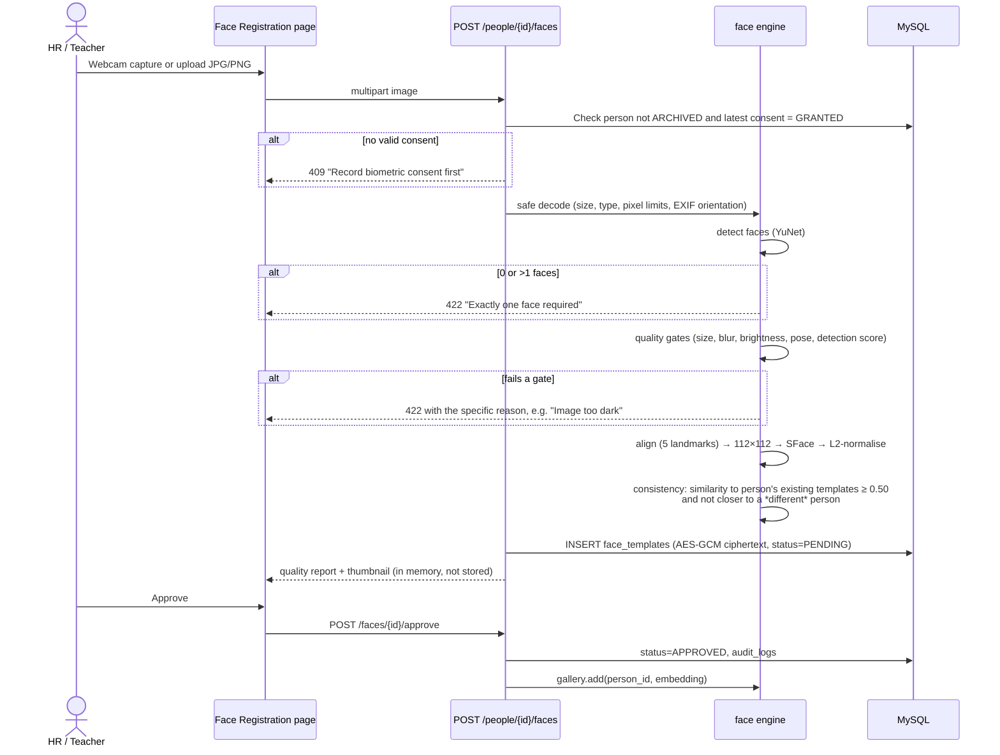
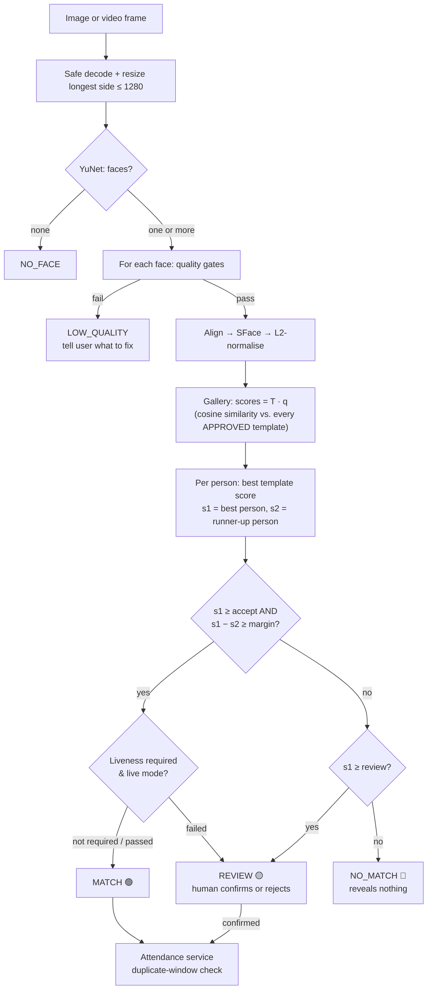

# 3. Face Recognition Workflow

## 3.1 Models

| Stage | Model | File | Size | Licence | Output |
|-------|-------|------|------|---------|--------|
| Detection | **YuNet** (`cv2.FaceDetectorYN`) | `face_detection_yunet_2023mar.onnx` | 0.23 MB | MIT | Box, 5 landmarks (eyes, nose, mouth corners), confidence |
| Embedding | **SFace** (`cv2.FaceRecognizerSF`) | `face_recognition_sface_2021dec.onnx` | 37 MB | Apache‑2.0 | 128‑d float32 vector from a 112×112 aligned crop |

Both models come from the official [OpenCV Model Zoo](https://github.com/opencv/opencv_zoo).
`scripts/download_models.py` (Phase 4) downloads them into `backend/ml_models/` and checks their
SHA‑256 hashes.

**Feasibility check run during Phase 1** (scratch environment, Windows 10, Python 3.14):
`opencv-python-headless` 4.14.0 loaded both models. A blank image returned 0 faces. `alignCrop`
produced a 112×112 crop, and `feature()` returned a `(1, 128) float32` embedding. The self-similarity
was 1.0, as expected. This confirms the toolchain. It does **not** measure accuracy, which needs
real face data (Phase 7).

## 3.2 Enrollment (registering a face)

Notes

- **Recommended enrollment:** 3–5 images per person: frontal, slight left, slight right, and
  optionally with or without glasses. More variety lowers false non-matches.
- The **consistency check** catches mistakes such as enrolling the wrong person's photo, or a
  duplicate person who is already registered under another ID.
- The original image is discarded after embedding. The thumbnail shown for approval exists only in
  the HTTP response.

### Quality gates (initial values, tuned in Phase 7)

| Check | How | Enrollment | Scan |
|-------|-----|-----------|------|
| Face size | Box short side in px | ≥ 100 | ≥ 60 |
| Detection score | YuNet confidence | ≥ 0.90 | ≥ 0.80 |
| Sharpness | Variance of the Laplacian on the aligned grey crop | ≥ provisional threshold | lower threshold |
| Brightness | Mean grey level of the crop | 50–210 | 35–225 |
| Pose (yaw) | Horizontal nose offset from the eye midpoint ÷ eye distance | \|r\| ≤ 0.25 | \|r\| ≤ 0.40 |
| Pose (roll) | Angle of the eye line | ≤ 20° | ≤ 30° |

A failed gate returns **LOW_QUALITY** with an actionable message ("Move closer", "Too dark",
"Face the camera"). It never returns "No match", so poor capture is not confused with an unknown person.

## 3.3 Identification (scanning)

### Matching math

- Embeddings are L2-normalised, so cosine similarity is a dot product. The gallery is a NumPy matrix
  `T` of shape (templates × 128) plus a parallel `person_ids` array. Scoring a face is `T @ q`.
- The person score is the **max over that person's templates**. The runner-up `s2` is the best score
  of a *different* person. Requiring a margin `s1 − s2` keeps the system from picking a winner
  between two similar-looking people (siblings, twins).
- **Only** people with APPROVED templates, a current GRANTED consent, and status ACTIVE or INACTIVE
  are in the gallery. Nobody else can ever be matched.

### Thresholds

| Setting | Initial | Source |
|---------|---------|--------|
| `review_threshold` | 0.363 | OpenCV's published SFace cosine threshold (tuned on the LFW benchmark) |
| `accept_threshold` | 0.50 | Deliberately stricter than the published value, so borderline matches go to a human |
| `min_margin` | 0.06 | Starting point |

These numbers are **starting points, not validated values**. LFW is web celebrity photos, which is
different from your camera, lighting and population. Phase 7 adds `scripts/calibrate_threshold.py`:

1. Build genuine pairs (same person, different photos) and impostor pairs (different people) from
   consenting test subjects captured with **your** webcam and room lighting.
2. Plot both score distributions. Report the false-match rate (FMR) and false-non-match rate (FNMR)
   at each candidate threshold.
3. Choose `accept_threshold` for a target FMR (for example ≤ 0.1 % on the test set). Put the
   overlapping band into REVIEW.
4. Record the dataset size and results in the docs. A small dataset gives only a rough estimate,
   and the docs will say so.

**A score is not a probability.** "0.62" means "the vectors are this similar". It does **not** mean
"62 % likely to be this person". The UI shows the score with a band label (High / Uncertain / Low)
and never as a percentage of certainty.

### Live webcam mode

1. `POST /scan/live/sessions` creates a short-lived (60 s) in-memory session. If liveness is
   enabled, it also returns a random challenge sequence, e.g. `["TURN_LEFT", "CENTER"]`.
2. The browser shows the camera preview and posts a downscaled JPEG frame about every 500 ms to
   `/frames`. Each reply contains the face box (for the overlay), a quality hint, and progress.
3. The **largest** face is used in live mode. If several faces are visible, the UI shows "Only one
   person in front of the camera" and the frames don't count.
4. A decision is made only after **3 consistent frames**: the same top person, each above threshold.
   One lucky frame cannot cause a match. Exactly one `scan_events` row is written per decision.
5. After MATCH, if `auto_record_on_match` is on, the attendance service records a check-in or
   check-out (or reports a duplicate). The operator can always undo it with a voided correction.

### Upload image mode

- JPG, JPEG or PNG only, ≤ 5 MB, ≤ 4096 × 4096 px. The real format is checked from the file
  contents, not the extension.
- Every detected face (up to 10) gets its own result card and its own `scan_events` row, with boxes
  drawn on the preview. Zero faces gives a single NO_FACE result.
- Upload mode **does not record attendance automatically**. The operator presses "Record check-in"
  on a MATCH card. This is because a photo proves nothing about presence right now.

## 3.4 What each outcome reveals

| Outcome | Shown to operator | Stored |
|---------|-------------------|--------|
| MATCH 🟢 | Photo, name, person code, department/class, position/grade, status, score band. Contact fields only with `people.contact.read`. Recent attendance only with `attendance.read`. | scan_event + optional attendance |
| REVIEW 🟡 | To users with `scan.review`: the candidate's photo, name and code, side by side with the live face, plus Confirm / Not this person. Users without the permission see "Needs review by authorised staff". | scan_event (PENDING → CONFIRMED/REJECTED) |
| NO_MATCH 🔴 | "No match found", with options: retry, or use manual / ID attendance. **No candidate names, no "closest person".** | scan_event with score only |
| LOW_QUALITY / NO_FACE | A specific capture hint | scan_event |
| LIVENESS_FAILED | "Could not verify a live person — please follow the on-screen prompt or use manual check-in" | scan_event |

## 3.5 Liveness / presentation-attack detection (optional)

**Layer 1 (built in Phase 4): randomised head-turn challenge.** The server picks a random order of
poses. It checks that the yaw ratio (from YuNet landmarks) moves in the requested direction within
the time limit, and that **every frame matches the same identity** (similarity ≥ accept threshold).
YuNet has only 5 landmarks, which is not enough to detect blinks reliably, so blink detection is
not used.

**Layer 2 (optional, off by default): passive anti-spoofing model.** A lightweight ONNX texture
classifier, such as the MiniFASNet models from *Silent-Face-Anti-Spoofing* (Apache‑2.0), can be
added behind the same interface. It is enabled only after it has been evaluated on your own camera.

**Limitations (shown in the Settings page and the README):**

- A head-turn challenge stops a **still printed photo or a phone showing a still image**. It does
  **not** reliably stop a replayed video of the person turning their head, a deepfake video, or a
  3D mask.
- Passive models trained on public datasets often perform worse on new cameras and lighting.
- Neither layer has been tested against a standard such as ISO/IEC 30107-3. This system must not be
  described as "spoof-proof".
- Because of these limits, a liveness failure leads to **REVIEW or a manual alternative, never an
  automatic denial**, and the system is suitable for low-stakes attendance, not for security access control.

## 3.6 Accuracy limitations & safeguards

| Risk | Mitigation |
|------|------------|
| Poor lighting, blur, extreme angles | Quality gates return actionable hints instead of a wrong answer. Enroll several poses. |
| Ageing, glasses, masks, hairstyle changes | Multiple templates, re-enrollment workflow, and REVIEW for borderline scores |
| Look-alikes / twins | Margin rule, so near-ties go to REVIEW |
| Demographic performance differences | Public face models can be less accurate for some groups. Calibrate on a representative local sample and watch REVIEW/NO_MATCH rates. |
| Wrong attendance | Every face-based record links to its scan_event. Corrections are voided and replaced with an audit trail. |
| Over-reliance | Recognition only *assists* attendance. Manual and ID-lookup methods are always available and equally valid. Nothing is automatically denied. |
